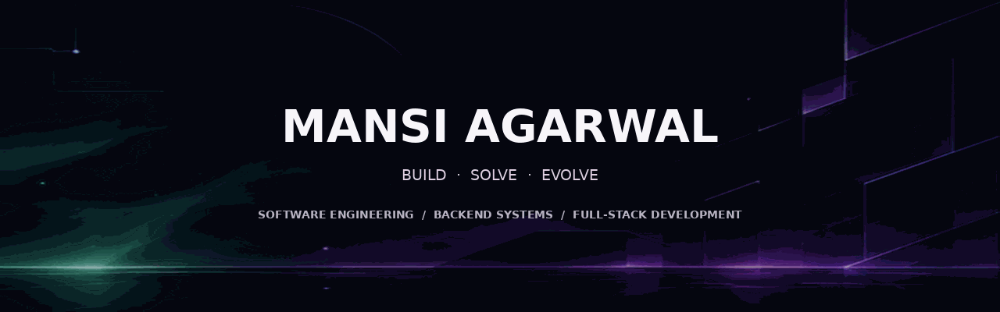

 

 

# MANSI

### BUILD. SOLVE. EVOLVE.

**Software Engineering · Backend Systems · Full-Stack Development**

[GitHub](https://github.com/maanncodes09) &nbsp;·&nbsp; [Repositories](https://github.com/maanncodes09?tab=repositories) &nbsp;·&nbsp; [LinkedIn](YOUR_LINKEDIN_URL) &nbsp;·&nbsp; [Email](mailto:YOUR_EMAIL)

 

---

<table>
<tr>
<td width="58%" valign="top">

## 01 / ABOUT

  

I'm a Computer Science undergraduate interested in building practical software, understanding how systems work behind the scenes, and becoming a stronger engineer with every project.

- Focused on **backend engineering and full-stack development**
- Building applications with the **MERN stack**
- Learning **Java, Spring Boot, REST APIs and system design**
- Practising **Data Structures and Algorithms**
- Interested in scalable systems, clean architecture and real-world problem solving

</td>
<td width="42%" valign="top">

## 02 / CURRENTLY EXPLORING

**Backend Engineering**
- Java · Spring Boot
- REST API design
- Authentication and authorization

**Core Computer Science**
- DSA · Operating Systems
- DBMS · Computer Networks

**Engineering Practices**
- Git · Postman
- Database design
- System design fundamentals

</td>
</tr>
</table>

---

## 03 / SELECTED PROJECTS

<table>
<tr>
<td width="50%" valign="top">

### 01. Enterprise Helpdesk & Incident Management

**MERN Stack · Collaborative Project**

A platform concept for managing support requests, incident workflows and issue resolution.

`React` `Node.js` `Express` `MongoDB`

*Currently in development.*

</td>
<td width="50%" valign="top">

### 02. Personal Finance Dashboard

**MERN Stack · Personal Project**

A finance management application to track income, expenses, budgets and savings through an analytics-focused dashboard.

`React` `Node.js` `Express` `MongoDB`

*Currently in development.*

</td>
</tr>
<tr>
<td width="50%" valign="top">

### 03. TaskFlow

**Smart Task Management System**

A task management project focused on organising work and improving productivity.

`JavaScript` `HTML` `CSS`

[View repository](https://github.com/maanncodes09/TaskFlow---Smart-Task-Management-System)

</td>
<td width="50%" valign="top">

### 04. Food²

**Restaurant Management Platform**

A restaurant web application with menu browsing, reservation functionality, authentication and backend API integration.

`JavaScript` `Node.js` `Express` `MongoDB`

[Explore my repositories](https://github.com/maanncodes09?tab=repositories)

</td>
</tr>
</table>

---

## 04 / TECHNOLOGY STACK

**LANGUAGES**

 

**FRAMEWORKS & RUNTIME**

 

**DATABASES & TOOLS**

---

## 05 / GITHUB ANALYTICS

 

## 06 / MILESTONES

<table>
<tr>
<td width="33%" align="center" valign="top">

**GirlScript Summer of Code**

2026 Contributor

</td>
<td width="33%" align="center" valign="top">

**SheFi**

Season 16 · Full Scholarship

</td>
<td width="33%" align="center" valign="top">

**MongoDB**

Student Basic Certification

</td>
</tr>
</table>

---

## LET'S CONNECT

**Always open to learning, building and collaborating on meaningful projects.**

[GitHub](https://github.com/maanncodes09) &nbsp;·&nbsp; [LinkedIn](YOUR_LINKEDIN_URL) &nbsp;·&nbsp; [Email](mailto:YOUR_EMAIL)

 

BUILD WITH CURIOSITY. ENGINEER WITH INTENTION.

