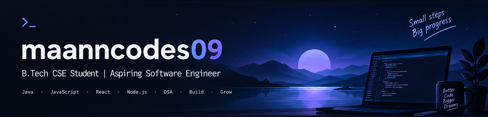

<!-- =========================================
     MANSI AGARWAL | GITHUB PROFILE
     Premium Dark Engineering Portfolio
     ========================================= -->

 

<table width="100%">
<tr>
<td width="33%" valign="top">

<h3 align="center">01 / BUILD</h3>

<h2 align="center">Create</h2>

Building practical applications and turning ideas into working software.

<a href="https://github.com/maanncodes09?tab=repositories">EXPLORE PROJECTS ↗</a>

</td>
<td width="33%" valign="top">

<h3 align="center">02 / ENGINEERING</h3>

<h2 align="center">Explore</h2>

Java, DSA, backend development, APIs and software architecture.

<a href="https://github.com/maanncodes09">EXPLORE GITHUB ↗</a>

</td>
<td width="33%" valign="top">

<h3 align="center">03 / COMMUNITY</h3>

<h2 align="center">Connect</h2>

Open to meaningful collaborations, new ideas and engineering opportunities.

<a href="https://github.com/maanncodes09">SAY HELLO ↗</a>

</td>
</tr>
</table>

 

## 01 / ABOUT ME

**Hey, I'm Mansi.**

I'm a Computer Science undergraduate focused on becoming a strong software engineer.

I enjoy building full-stack applications, understanding backend systems, solving algorithmic problems and exploring how reliable software is designed.

- 🎓 B.Tech Computer Science & Engineering
- 💻 Practicing DSA using Java
- ⚙️ Building applications with the MERN stack
- 🗄️ Exploring databases, REST APIs and backend architecture
- 🚀 Interested in real-world engineering problems and collaboration

 

## 02 / TECHNICAL EXPERTISE

<table width="100%">
<tr>
<td width="50%" valign="top">

**LANGUAGES**

**FRONTEND**

</td>
<td width="50%" valign="top">

**BACKEND**

**DATABASES**

**TOOLS**

</td>
</tr>
</table>

 

## 03 / SELECTED PROJECTS

<table width="100%">
<tr>
<td width="50%" valign="top">

### 01. Personal Finance Dashboard

A financial management platform for tracking income, expenses, budgets and savings.

**Focus areas**
- Financial analytics
- Budget management
- Transaction management
- Data visualization

`MERN STACK`

<a href="https://github.com/maanncodes09?tab=repositories">VIEW PROJECT ↗</a>

</td>
<td width="50%" valign="top">

### 02. FlowBoard

A Kanban-style task management workspace with interactive task organization.

**Focus areas**
- Drag and drop
- Undo and redo
- Task filtering
- State management

`HTML · CSS · JAVASCRIPT`

<a href="https://github.com/maanncodes09/TaskFlow---Smart-Task-Management-System">VIEW PROJECT ↗</a>

</td>
</tr>
<tr>
<td width="50%" valign="top">

### 03. Food²

A restaurant web application with menu browsing, reservations and authentication.

**Focus areas**
- REST API integration
- Authentication
- Database operations
- Reservation workflows

`MERN STACK`

<a href="https://github.com/maanncodes09?tab=repositories">VIEW PROJECT ↗</a>

</td>
<td width="50%" valign="top">

### 04. Enterprise Helpdesk System

A collaborative project exploring enterprise ticket and incident management.

**Planned focus areas**
- Ticket lifecycle management
- Role-based access control
- Backend workflows
- Database design

`MERN STACK · IN DEVELOPMENT`

</td>
</tr>
</table>

 

## 04 / ENGINEERING ACTIVITY

  

  

 

## 05 / CURRENTLY EXPLORING

| Area | Focus |
|:---|:---|
| Data Structures & Algorithms | Problem-solving with Java |
| Backend Engineering | API design and authentication |
| Databases | Data modeling and query optimization |
| System Design | Scalable software fundamentals |
| Full-Stack Development | Building complete applications |

 

## 06 / ACHIEVEMENTS & COMMUNITY

- Google Summer of Code / GirlScript Summer of Code — GSSoC 2026 Contributor
- SheFi Season 16 — Scholarship recipient
- MongoDB Student Basic Certification

 

## 07 / LET'S CONNECT

  

**BUILD. SOLVE. EVOLVE.**

Consistent progress. Better engineering. Meaningful work.

